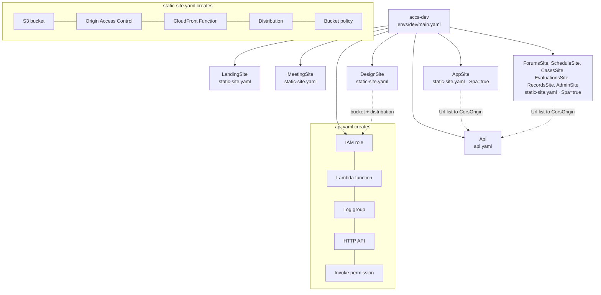
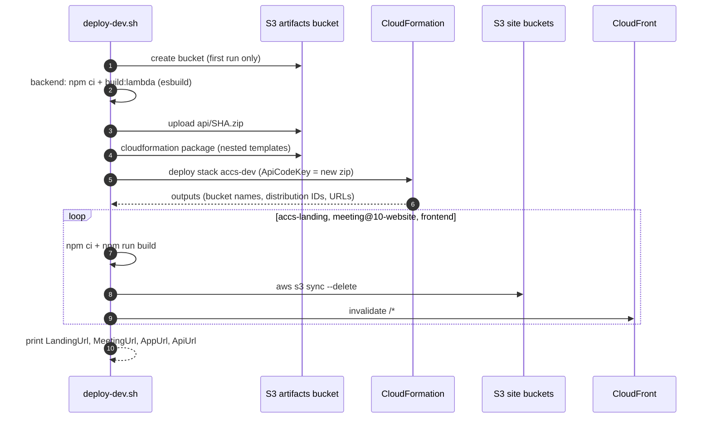
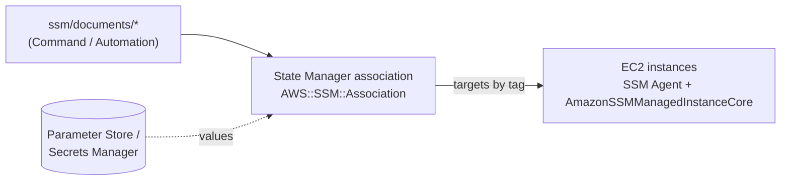

# Architecture

AWS infrastructure provisioned with CloudFormation and configured with AWS Systems Manager (SSM). System concept not defined yet.

- `cloudformation/` — AWS provisioning
  - `templates/` — nested stacks: `static-site.yaml` (private S3 + CloudFront), `api.yaml` (Lambda + HTTP API), `github-deploy-role.yaml` (GitHub OIDC role that publishes one site)
  - `envs/dev/main.yaml` — dev root stack: accs-landing, meeting@10-website, the seven accs-system app sites (portal + forums, schedule, cases, evaluations, records, admin), accs-system backend, design system site (+ its deploy role)
- `scripts/deploy-dev.sh` — builds every app, deploys the stack, uploads the sites
  - `scripts/deploy-app-sites.sh` — deploys only the ACCS app sites and API (never landing or meeting)
- `ssm/` — host configuration
  - `documents/` — SSM Command/Automation documents, applied via State Manager associations declared in CloudFormation (`AWS::SSM::Association`), targeting instances by tag
- `iam/` — inline policies of the IAM users (users and access keys are created by hand, see Access)
- `adr/` — architecture decision records (one per decision)
- `diagrams/` — system, deployment, and data-flow diagrams

Configuration values and secrets go in SSM Parameter Store / Secrets Manager, not in the repo.

## How it fits together

### Runtime (dev)


- Buckets block all public access; only their own CloudFront distribution can read them (Origin Access Control).
- Missing paths: the Next.js sites return `/404.html`, the frontend SPA falls back to `/index.html` for client-side routing.
- The API only accepts browser requests from the seven ACCS app sites' CloudFront URLs: `CORS_ORIGIN` is a comma-separated list the backend parses (`AppSite` plus the six module sites).
- The app is seven CloudFront/S3 sites, all `static-site.yaml` with `Spa=true`, each serving the same frontend `dist/`: `AppSite` (the portal, its distribution and URL unchanged), `ForumsSite`, `ScheduleSite`, `CasesSite`, `EvaluationsSite`, `RecordsSite`, `AdminSite`. Outputs per site: `<Prefix>Url`, `<Prefix>Bucket`, `<Prefix>DistributionId` (prefix `App`, `Forums`, `Schedule`, `Cases`, `Evaluations`, `Records`, `Admin`). The `SiteOrigins` output is a JSON map of site key to URL (`{"portal":...,"forums":...,"admin":...}`) that the frontend build reads as `VITE_SITE_ORIGINS`.
- The design system site (`DesignSite`) is not uploaded by `deploy-dev.sh`: pushing a `v*` tag in `MeetingAt10/meetingatten-design-system` runs its `deploy-site.yml`, which assumes `DesignDeployRole` through GitHub OIDC (no AWS keys in GitHub) and may only sync that bucket and invalidate that distribution. After the first stack deploy, set the repository variables `DESIGN_SITE_ROLE_ARN`, `DESIGN_SITE_BUCKET`, `DESIGN_SITE_DISTRIBUTION_ID` and `DESIGN_SITE_URL` from the `Design*` outputs. If the account already has a GitHub OIDC provider, pass its ARN as `GithubOidcProviderArn`. The repo issues immutable OIDC subjects (`repo:MeetingAt10@343086680/meetingatten-design-system@1431974802:...`), so `DesignSystemRepository` uses that form; a renamed or re-created repo cannot assume the role.
- The CloudFront Function leaves `.../opengraph-image` and `.../twitter-image` paths (optionally with a `-<hash>` suffix) alone: Next.js writes those images without an extension.

### CloudFormation stacks



### Deploy flow (`scripts/deploy-dev.sh`)



### Host configuration (planned, SSM)

No EC2 hosts exist yet. When some are added, they are configured like this:



## Deploy (dev)

Target: AWS account behind the `meetingatten` CLI profile, `ap-southeast-1`. Needs sibling checkouts of `backend/`, `frontend/`, `../accs-landing`, `../meeting@10-website`.

```sh
pcore scripts/deploy-dev.sh
```

The script creates the `accs-dev-artifacts-<account>` bucket on first run, uploads the API bundle and nested templates there, deploys stack `accs-dev`, then syncs each site and invalidates CloudFront. Override with `AWS_PROFILE`, `STACK`, or `*_DIR` env vars.

To redeploy only the ACCS app and API, leaving landing and meeting untouched:

```sh
pcore scripts/deploy-app-sites.sh
SKIP_STACK=1 pcore scripts/deploy-app-sites.sh   # sites only: skip backend build and stack deploy
```

It builds the frontend once with `VITE_API_URL` and `VITE_SITE_ORIGINS` from the stack outputs, then syncs the build to all seven buckets and invalidates each distribution. Set `SESSION_SECRET` in the environment to inline it into the Lambda bundle, as backend CI does; without it the API signs sessions with a random per-instance key.

Sites get default `*.cloudfront.net` URLs; no custom domain yet.

## Access (IAM users)

Two IAM users with long-lived access keys, created by hand (not in CloudFormation, so no secret ever lands in a template or stack output). Keys are handed over as CSV files outside any repo and are never committed.

| User | For | Permissions |
|---|---|---|
| `dev` | Local work: `deploy-dev.sh`, stack changes | `PowerUserAccess` + `iam/dev-user-policy.json` (manage `accs-*` roles and the GitHub OIDC provider, which the stacks create) |
| `deploy` | App CI/CD | `iam/deploy-user-policy.json` only: read `accs-dev` outputs, sync the site buckets, invalidate the listed distributions, update the API Lambda code. No access to the artifacts bucket, so CI cannot alter the templates CloudFormation deploys |

- `dev` can create `accs-*` roles with any policy, so treat its key like an admin key.
- The deploy policy lists distribution IDs, not a wildcard (a wildcard would also allow invalidating landing and meeting). The site bucket pattern `accs-dev-*site-*-bucket-*` already covers the six new buckets, but after the first deploy that creates them, add their six `<Prefix>DistributionId` values to `InvalidateCdn`, and update it again if a site stack is recreated. Until then CI invalidation of the new sites fails with access denied: `aws iam put-user-policy --user-name deploy --policy-name deploy-sites-and-api --policy-document file://iam/deploy-user-policy.json`.
- The design system site does not use `deploy`: it publishes through `DesignDeployRole` (OIDC, ADR 0002).
- Rotate a key: `aws iam create-access-key --user-name <user>`, switch consumers over, then `aws iam delete-access-key --user-name <user> --access-key-id <old>`.
