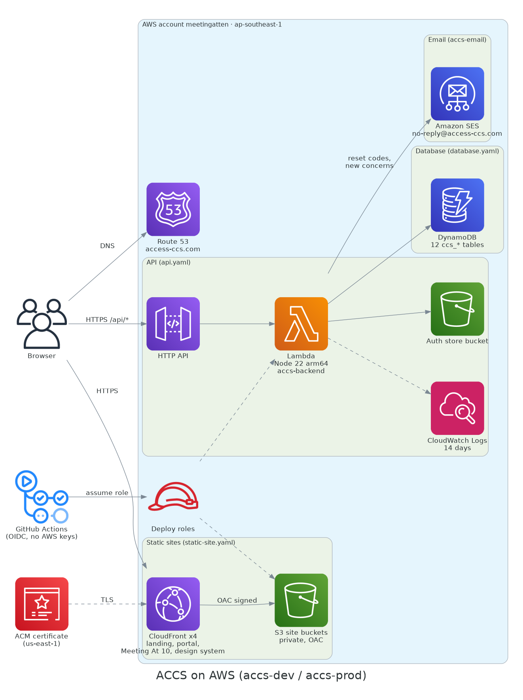
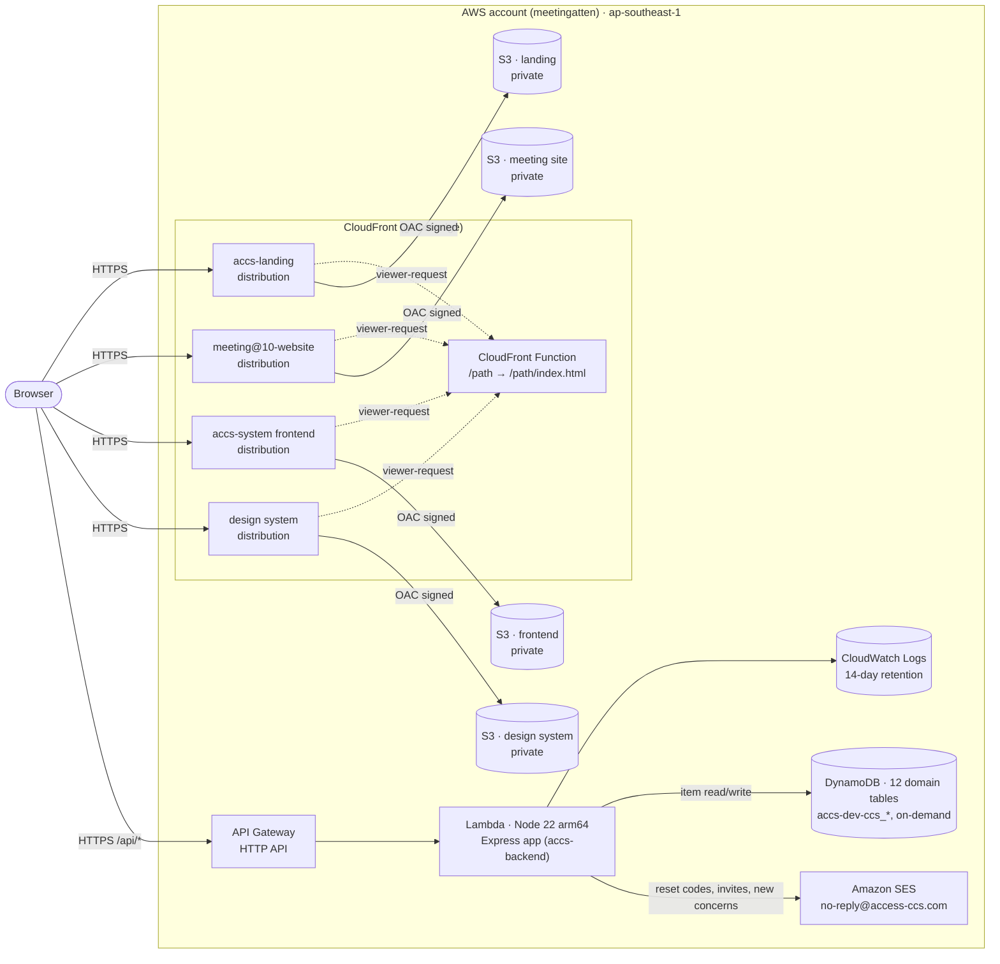
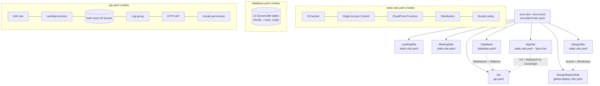
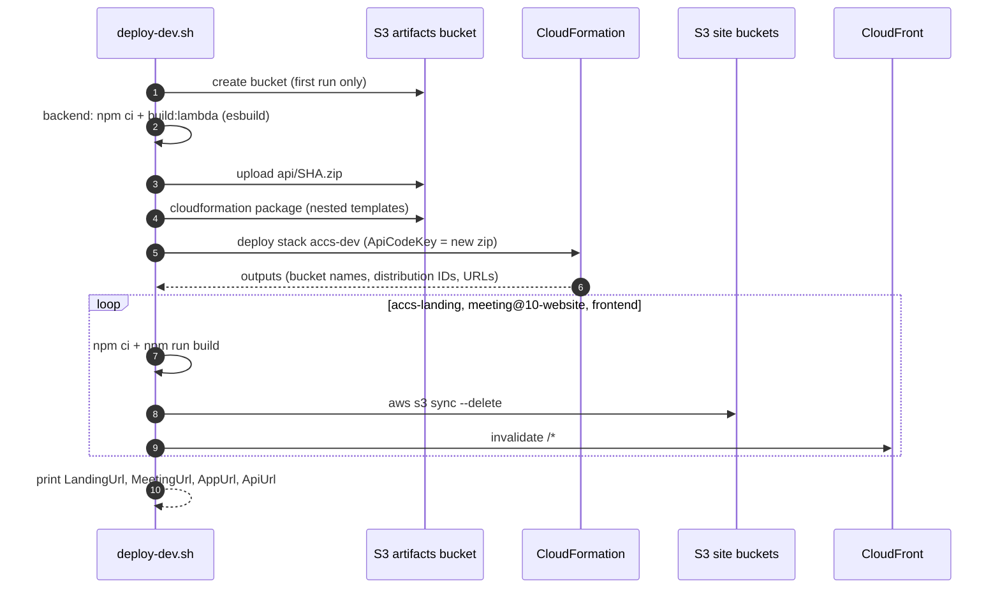
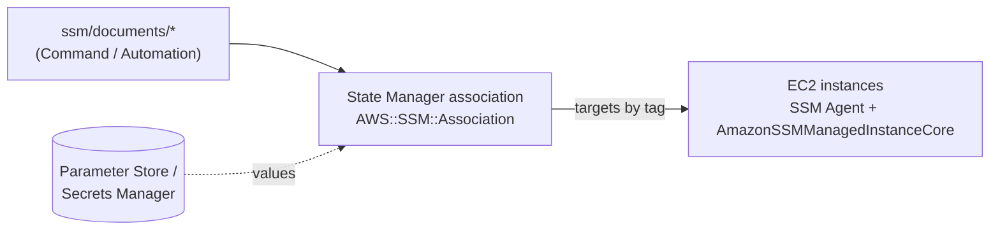

# Architecture

AWS infrastructure provisioned with CloudFormation and configured with AWS Systems Manager (SSM).



- `cloudformation/` — AWS provisioning
  - `templates/` — nested stacks: `static-site.yaml` (private S3 + CloudFront), `api.yaml` (Lambda + HTTP API), `database.yaml` (twelve DynamoDB domain tables), `github-deploy-role.yaml` (GitHub OIDC role that publishes one site), `github-infra-role.yaml` (GitHub OIDC role the infra CI assumes), `certificate.yaml` (us-east-1 ACM certificate)
  - `envs/dev/main.yaml` — root stack, deployed as both `accs-dev` and `accs-prod` (the `Env`, `HostSuffix` and `DesignRefPattern` parameters pick the environment): landing, meeting@10-website, the portal site, the API and its DynamoDB tables, the design system site and its deploy role
- `.github/workflows/deploy-infra.yml` — CI: lints templates on pull requests and on pushes that touch `cloudformation/` or the workflow; on `main` validates and deploys stacks `accs-dev` and then `accs-prod`, each when its change set is not empty (ADR 0005)
- `scripts/deploy-dev.sh` — builds every app, deploys the stack, uploads the sites
  - `scripts/deploy-app-sites.sh` — deploys only the ACCS portal and API (never landing or meeting)
- `ssm/` — host configuration
  - `documents/` — SSM Command/Automation documents, applied via State Manager associations declared in CloudFormation (`AWS::SSM::Association`), targeting instances by tag
- `iam/` — policies of the IAM users: an inline policy for `dev`, a managed policy for `deploy` (users and access keys are created by hand, see Access)
- `adr/` — architecture decision records (one per decision)
- `diagrams/` — the ACCS sitemap and system diagrams (see [Diagrams](#diagrams))

Configuration values and secrets go in SSM Parameter Store / Secrets Manager, not in the repo.

## Diagrams

- [`diagrams/sitemap.md`](diagrams/sitemap.md): every portal page by area, as a Mermaid diagram. Route details and access rules are in `sitemap.md` in the `accs-docs` repository.
- [`diagrams/accs-architecture.png`](diagrams/accs-architecture.png): the overview at the top of this README, drawn with the official AWS Architecture Icons by the Python [`diagrams`](https://diagrams.mingrammer.com/) library. Its source is `diagrams/accs_architecture.py`; the rebuild command (a `podman` container, so Graphviz need not be installed) is in that file's docstring.
- [`diagrams/accs-runtime.html`](diagrams/accs-runtime.html): the AWS runtime as an interactive page, with search, focus, relationship tracing and exports. Open it in a browser. Its source is `diagrams/accs-runtime.architecture.json`.

The runtime page is built with [Archify](https://github.com/tt-a1i/archify). Edit the JSON, then rebuild from the Archify skill directory, using absolute paths for the three repository paths:

```sh
node bin/archify.mjs deliver architecture <repo>/diagrams/accs-runtime.architecture.json <repo>/diagrams/accs-runtime.html --quality showcase --repo-root <repo>
```

Each component links to the file that defines it, pinned to the commit in `meta.repository.revision`. Update that revision when those files change.

## How it fits together

### Runtime (dev)



- Buckets block all public access; only their own CloudFront distribution can read them (Origin Access Control).
- Missing paths: the Next.js sites return `/404.html`, the frontend SPA falls back to `/index.html` for client-side routing.
- Accounts: `api.yaml` creates a private, encrypted, versioned `AuthStoreBucket` (retained on stack delete). The Lambda gets `AUTH_STORE_BUCKET` and may only read/write `auth-store.json` in it (plus `ListBucket`, so a missing object reads as empty). It holds registered accounts and scrypt password hashes; the backend reads it with ETag caching and writes it with a conditional put, so registrations and password changes survive cold starts and are seen by every Lambda instance.
- Class material files (accs-backend #44): `api.yaml` creates a private, encrypted `MaterialsBucket` (retained on stack delete) and gives the Lambda `MATERIALS_BUCKET` and `s3:PutObject`/`GetObject`/`DeleteObject` on `materials/*` only. Files never pass through the API: it checks access, then hands the browser a signed PUT (10 minutes, exact type and size, up to 25 MB) or a signed GET (5 minutes). The bucket's CORS allows `PUT` and `GET` from the portal origins (`CorsOrigin`), and a lifecycle rule aborts unfinished multipart uploads after a day.
- Database: `database.yaml` creates the twelve DynamoDB domain tables of the DOC006 data dictionary, named `accs-dev-ccs_identity`, `accs-dev-ccs_grievance`, … (on-demand, PITR, deletion protection, retained on stack delete; TTL on `ccs_identity`, `ccs_notification`, `ccs_assistant`). Generic keys `PK`/`SK` with overloaded indexes `GSI1`…`GSI6` (36 in total); tables, indexes, and deviations from DOC006 are in ADR 0004, which supersedes the single-table ADR 0003. The Lambda gets `TABLE_PREFIX` and item-level actions on the business tables and their indexes, but not `Scan`; on `ccs_audit` it may only add and read entries. The root stack outputs `TablePrefix`. The auth store bucket stays until the backend moves accounts into `ccs_identity`.
- The API only accepts browser requests from the portal: `CORS_ORIGIN` is a comma-separated list the backend parses (`AppSite`'s custom hostname and its CloudFront default).
- The app is one CloudFront/S3 site, `AppSite` (`static-site.yaml` with `Spa=true`), the portal. Every signed-in module (Forums, Schedule, Cases, Evaluations, Records, Admin) is a path on it, not a host ([docs delta](../docs/deltas/2026-11-05-one-portal-host.md)). Outputs: `AppUrl`, `AppBucket`, `AppDistributionId`.
- The landing site (`LandingSite`) exists in both stacks: `access-ccs.com` and `www.access-ccs.com` on prod, `dev.access-ccs.com` on dev.
- The design system site (`DesignSite`) is not uploaded by `deploy-dev.sh`: pushing a `v*` tag in `MeetingAt10/meetingatten-design-system` runs its `deploy-site.yml`, which assumes `DesignDeployRole` through GitHub OIDC (no AWS keys in GitHub) and may only sync that bucket and invalidate that distribution. After the first stack deploy, set the repository variables `DESIGN_SITE_ROLE_ARN`, `DESIGN_SITE_BUCKET`, `DESIGN_SITE_DISTRIBUTION_ID` and `DESIGN_SITE_URL` from the `Design*` outputs. If the account already has a GitHub OIDC provider, pass its ARN as `GithubOidcProviderArn`. The repo issues immutable OIDC subjects (`repo:MeetingAt10@343086680/meetingatten-design-system@1431974802:...`), so `DesignSystemRepository` uses that form; a renamed or re-created repo cannot assume the role.
- The CloudFront Function leaves `.../opengraph-image` and `.../twitter-image` paths (optionally with a `-<hash>` suffix) alone: Next.js writes those images without an extension.

### CloudFormation stacks



### Deploy flow (`scripts/deploy-dev.sh`)



### Host configuration (planned, SSM)

No EC2 hosts exist yet. When some are added, they are configured like this:



## Deploy (dev)

Target: AWS account behind the `meetingatten` CLI profile, `ap-southeast-1`. Needs sibling checkouts of `backend/`, `frontend/`, `../accs-landing`, `../meeting@10-website`.

```sh
pcore scripts/deploy-dev.sh
```

The script creates the `accs-dev-artifacts-<account>` bucket on first run, uploads the API bundle and nested templates there, deploys stack `accs-dev`, then syncs each site and invalidates CloudFront. Override with `AWS_PROFILE`, `STACK`, or `*_DIR` env vars.

To redeploy only the ACCS app and API, leaving landing and meeting untouched:

```sh
pcore scripts/deploy-app-sites.sh
SKIP_STACK=1 pcore scripts/deploy-app-sites.sh   # sites only: skip backend build and stack deploy
```

It builds the frontend with `VITE_API_URL` from the stack outputs, then syncs the build to the portal bucket and invalidates its distribution. Set `SESSION_SECRET` in the environment to build a new Lambda bundle with it inlined, as backend CI does. Without it the script keeps the current API code and only updates the stack. The script targets `accs-dev` unless `STACK` is set.

### Environments and hostnames (`access-ccs.com`)

`access-ccs.com` is registered with Route 53 in this account (hosted zone `Z09799202NPP9TLA01MFH`). The same root template, `envs/dev/main.yaml`, runs as two stacks:

| Stack | Branch | `Env` | `HostSuffix` | Tables |
|---|---|---|---|---|
| `accs-prod` | `main` (design system: `v*` tags) | `prod` | empty | `accs-prod-ccs_*` |
| `accs-dev` | `dev` (design system: `master`) | `dev` | `-dev` | `accs-dev-ccs_*` |

| Site | Prod hostname | Dev hostname |
|---|---|---|
| Landing | `access-ccs.com`, `www.access-ccs.com` | `dev.access-ccs.com` |
| Portal (every signed-in module) | `portal.access-ccs.com` | `portal-dev.access-ccs.com` |
| Design system | `design.access-ccs.com` | `design-dev.access-ccs.com` |
| Meeting At 10 | `team.access-ccs.com` | `team-dev.access-ccs.com` |

Each stack has its own API, Lambda, tables and auth store, so dev data and accounts never reach prod. The seeded accounts' shared password is the `NoEcho` stack parameter `SeedPassword` (Lambda `SEED_PASSWORD`), different per stack. Set it by hand with `aws cloudformation deploy ... --parameter-overrides SeedPassword='<value>'`; CI deploys keep the current value. When it is empty, the API disables seeded sign-in. The stack name `accs-dev` predates the split; it is the dev environment.

App CI picks the stack from the branch: `main` deploys to `accs-prod`, `dev` to `accs-dev` (frontend, backend, landing and meeting@10). Backend CI reads the Lambda name from the stack output `ApiFunctionName`.

CloudFront only accepts certificates from us-east-1, so the certificate for `access-ccs.com` and `*.access-ccs.com` lives in a separate stack, `accs-dev-certificate`, in us-east-1. Both environments share it. It validates itself through a DNS record in the hosted zone. Deploy it by hand, and pass its ARN to `envs/dev/main.yaml` as the `CertificateArn` default:

```sh
aws cloudformation deploy --region us-east-1 --template-file templates/certificate.yaml \
  --stack-name accs-dev-certificate --no-fail-on-empty-changeset
```

Email goes out through Amazon SES from the domain identity `access-ccs.com`, in ap-southeast-1 (the API Lambda's region). The identity and its three Easy DKIM CNAMEs live in a separate stack, `accs-email` (`templates/email.yaml`), because an SES identity is account-wide per region and both environments share it. CI does not deploy it. Deploy it by hand once:

```sh
aws cloudformation deploy --template-file templates/email.yaml \
  --stack-name accs-email --region ap-southeast-1 --no-fail-on-empty-changeset
```

`api.yaml` sets the Lambda's `MAIL_FROM` from the `MailFrom` parameter and allows `ses:SendEmail` on that identity only. The root stack passes `no-reply@access-ccs.com` to both dev and prod. The address needs no mailbox. SES production access was granted on 2026-11-12, so the account is out of the sandbox: it sends to any address, up to 50,000 emails a day at 14 per second. The account-level suppression list is on for bounces and complaints.

`static-site.yaml` adds the aliases, the certificate, and Route 53 A/AAAA alias records when `DomainName` is set. Its `Url` output is then the custom hostname, so the API's CORS list follows automatically. The CloudFront default hostnames (`DefaultUrl`) still work, and they stay in the CORS list too.

A hostname can sit on only one distribution, so moving a hostname between stacks means removing it from one stack before adding it to the other. Sites are created in a `DependsOn` chain because CloudFront rejects several function creations at once ("Rate exceeded").

### CI deploy (`deploy-infra.yml`)

Pushing to `main` with changes under `cloudformation/` (or to the workflow file), or running the workflow by hand, deploys both stacks: `cfn-lint`, then `validate-template`, `cloudformation package`, and `cloudformation deploy --no-fail-on-empty-changeset` for `accs-dev` and then for `accs-prod` (nothing deploys if nothing changed). The prod deploy overrides `Env`, `HostSuffix`, `DesignRefPattern` and `GithubOidcProviderArn`. Pull requests only lint. The job assumes `github-accs-infra-deploy` through GitHub OIDC (ARN in the repo variable `INFRA_DEPLOY_ROLE_ARN`); that role is in its own stack, `accs-infra-ci`, which you deploy by hand:

```sh
aws cloudformation deploy --template-file cloudformation/templates/github-infra-role.yaml \
  --stack-name accs-infra-ci --capabilities CAPABILITY_NAMED_IAM \
  --parameter-overrides OidcProviderArn=arn:aws:iam::128908383744:oidc-provider/token.actions.githubusercontent.com
```

Stack parameters keep their current values, so CI never changes `ApiCodeKey`. Run `deploy-dev.sh` when the sites or the API bundle need rebuilding too.

## Access (IAM users)

Two IAM users with long-lived access keys, created by hand (not in CloudFormation, so no secret ever lands in a template or stack output). Keys are handed over as CSV files outside any repo and are never committed.

| User | For | Permissions |
|---|---|---|
| `dev` | Local work: `deploy-dev.sh`, stack changes | `PowerUserAccess` + `iam/dev-user-policy.json` (manage `accs-*` roles and the GitHub OIDC provider, which the stacks create) |
| `deploy` | App CI/CD | managed policy `accs-deploy-sites-and-api` (`iam/deploy-user-policy.json`) only: read `accs-dev` and `accs-prod` outputs, sync the site buckets, invalidate the listed distributions, update the API Lambda code. No access to the artifacts bucket, so CI cannot alter the templates CloudFormation deploys |

- `dev` can create `accs-*` roles with any policy, so treat its key like an admin key.
- The deploy policy lists distribution IDs, not a wildcard (a wildcard would also allow invalidating landing and meeting). The bucket patterns `accs-dev-*site-*-bucket-*` and `accs-prod-*site-*-bucket-*` cover every site bucket, but `InvalidateCdn` lists the distribution IDs of both stacks: update it whenever a site stack is created or recreated. Until then CI invalidation of the new sites fails with access denied. The policy is too large for an inline user policy (2048-byte limit), so it is the managed policy `accs-deploy-sites-and-api`, attached to `deploy`. Publish a new version with `aws iam create-policy-version --policy-arn arn:aws:iam::128908383744:policy/accs-deploy-sites-and-api --policy-document file://iam/deploy-user-policy.json --set-as-default` (IAM keeps at most five versions; delete an old one first if needed).
- The design system site does not use `deploy`: it publishes through `DesignDeployRole` (OIDC, ADR 0002).
- Rotate a key: `aws iam create-access-key --user-name <user>`, switch consumers over, then `aws iam delete-access-key --user-name <user> --access-key-id <old>`.
