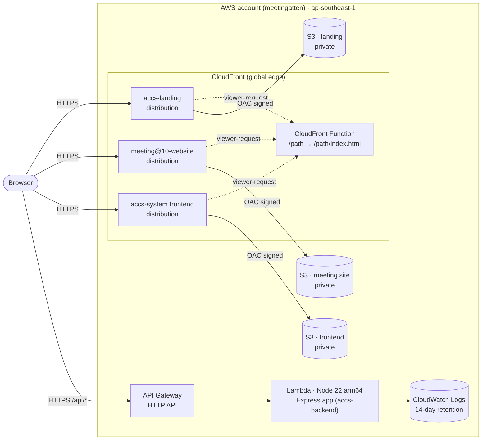
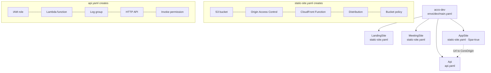
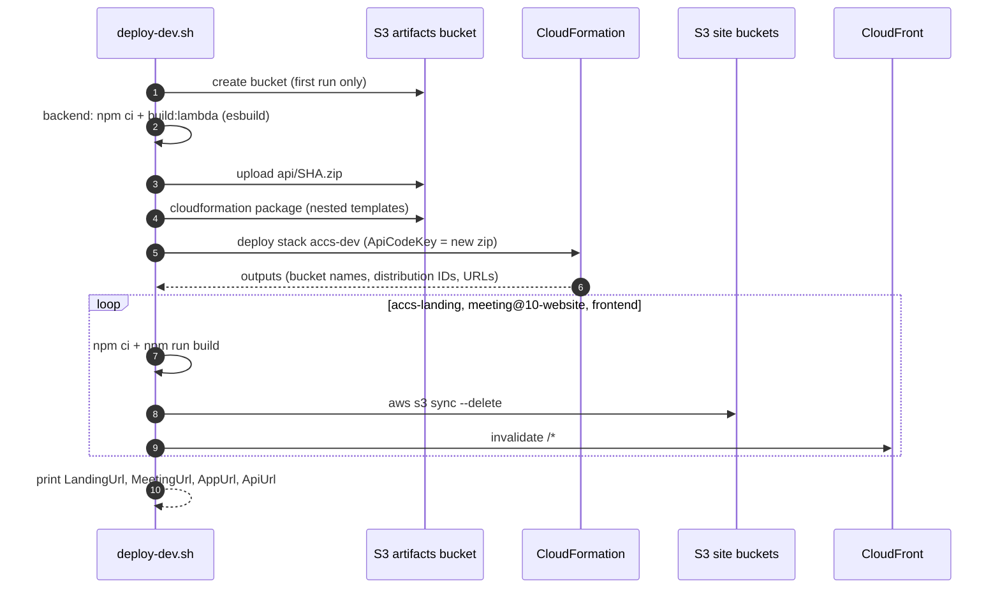
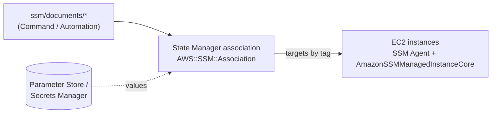

# Architecture

AWS infrastructure provisioned with CloudFormation and configured with AWS Systems Manager (SSM). System concept not defined yet.

- `cloudformation/` — AWS provisioning
  - `templates/` — nested stacks: `static-site.yaml` (private S3 + CloudFront), `api.yaml` (Lambda + HTTP API)
  - `envs/dev/main.yaml` — dev root stack: accs-landing, meeting@10-website, accs-system frontend, accs-system backend
- `scripts/deploy-dev.sh` — builds every app, deploys the stack, uploads the sites
- `ssm/` — host configuration
  - `documents/` — SSM Command/Automation documents, applied via State Manager associations declared in CloudFormation (`AWS::SSM::Association`), targeting instances by tag
- `adr/` — architecture decision records (one per decision)
- `diagrams/` — system, deployment, and data-flow diagrams

Configuration values and secrets go in SSM Parameter Store / Secrets Manager, not in the repo.

## How it fits together

### Runtime (dev)



- Buckets block all public access; only their own CloudFront distribution can read them (Origin Access Control).
- Missing paths: the Next.js sites return `/404.html`, the frontend SPA falls back to `/index.html` for client-side routing.
- The API only accepts browser requests from the frontend's CloudFront URL (`CORS_ORIGIN`).

### CloudFormation stacks



### Deploy flow (`scripts/deploy-dev.sh`)



### Host configuration (planned, SSM)

No EC2 hosts exist yet. When some are added, they are configured like this:



## Deploy (dev)

Target: AWS account behind the `meetingatten` CLI profile, `ap-southeast-1`. Needs sibling checkouts of `backend/`, `frontend/`, `../accs-landing`, `../meeting@10-website`.

```sh
pcore scripts/deploy-dev.sh
```

The script creates the `accs-dev-artifacts-<account>` bucket on first run, uploads the API bundle and nested templates there, deploys stack `accs-dev`, then syncs each site and invalidates CloudFront. Override with `AWS_PROFILE`, `STACK`, or `*_DIR` env vars.

Sites get default `*.cloudfront.net` URLs; no custom domain yet.
