# ACCS sitemap

Every page of the ACCS portal by area, plus the separate public landing site. Page IDs match the page specs. The route details and access rules live in `sitemap.md` in the `accs-docs` repository; update this diagram when they change.

```mermaid
flowchart LR
  landing["accs-landing (separate public site)<br/>/ Product landing"]
  app["accs-system/frontend"]
  app --> g_entry(["Entry and home"])
  g_entry --> n1["P01 /<br/>Redirect: /home when signed in, else /sign-in"]
  g_entry --> n2["P02 /sign-in<br/>Sign in, forgot password (no app shell)"]
  g_entry --> n3["/first-login<br/>Choose username and password (temporary credentials only)"]
  g_entry --> n4["/accounts<br/>Accounts (Dean: activate secretary; Secretary: manage accounts)"]
  g_entry --> n5["P03 /home<br/>Dashboard, one page with role variants"]
  app --> g0(["Community"])
  g0 --> n6["P04 /feed<br/>Feed and announcements"]
  g0 --> n7["P05 /feed/new<br/>New post or announcement"]
  g0 --> n8["P06 /feed/$postId<br/>Post and comments"]
  g0 --> n9["P07 /spaces<br/>My classes / teaching load / program sections"]
  g0 --> n10["P08 /spaces/$spaceId<br/>Section or subject space"]
  g0 --> n11["P09 /organizations<br/>CCS organizations"]
  g0 --> n12["P10 /organizations/$orgId<br/>Organization space"]
  app --> g1(["Messages"])
  g1 --> n13["P11 /messages<br/>Conversations"]
  g1 --> n14["P12 /messages/$threadId<br/>Conversation"]
  app --> g2(["Schedule"])
  g2 --> n15["P13 /calendar<br/>Calendars and to-dos"]
  g2 --> n16["P14 /consultations<br/>Requests (student) / incoming requests (professor)"]
  g2 --> n17["P15 /consultations/faculty/$facultyId<br/>A professor's open times"]
  g2 --> n18["P16 /consultations/requests/$requestId<br/>Request detail"]
  g2 --> n19["P17 /consultations/availability<br/>Manage availability (professor)"]
  app --> g3(["My reports (student)"])
  g3 --> n20["P18 /reports<br/>My reports"]
  g3 --> n21["P19 /reports/new<br/>Report wizard"]
  g3 --> n22["P20 /reports/$reportId<br/>Report detail and secure conversation"]
  app --> g4(["Cases (handlers)"])
  g4 --> n23["P21 /cases<br/>Case queue (scoped by role and stage)"]
  g4 --> n24["P22 /cases/$caseId<br/>Case workspace"]
  g4 --> n25["P23 /cases/clusters<br/>Similar-report groups"]
  g4 --> n26["P24 /cases/clusters/$clusterId<br/>Group review"]
  g4 --> n27["P25 /analytics<br/>Grievance analytics"]
  app --> g5(["Evaluations"])
  g5 --> n28["P26 /evaluations<br/>Assigned forms and entry points"]
  g5 --> n29["P27 /evaluations/forms/$assignmentId<br/>Fill in a form"]
  g5 --> n30["P28 /evaluations/results<br/>Results overview"]
  g5 --> n31["P29 /evaluations/results/$facultyId<br/>One faculty member's results"]
  g5 --> n32["P30 /evaluations/cycles<br/>Cycles (Dean)"]
  g5 --> n33["P31 /evaluations/cycles/$cycleId<br/>Cycle editor and monitor (Dean)"]
  g5 --> n34["P32 /evaluations/cycles/$cycleId/review<br/>Question review (professor)"]
  app --> g6(["Student records"])
  g6 --> n35["P33 /records<br/>Find a student"]
  g6 --> n36["P34 /records/$studentId<br/>Offenses, standing, restrictions, Good Moral"]
  g6 --> n37["P35 /restrictions<br/>Restriction queue"]
  g6 --> n38["P36 /standing<br/>My account standing (student)"]
  app --> g7(["People and account"])
  g7 --> n39["P37 /directory<br/>Personnel directory"]
  g7 --> n40["P38 /people/$userId<br/>Profile"]
  g7 --> n41["P39 /profile<br/>My profile"]
  g7 --> n42["P40 /notifications<br/>Notification inbox"]
  g7 --> n43["P41 /assistant<br/>AI assistant (also a drawer on every page)"]
  g7 --> n44["P42 /help<br/>FAQ and how-to"]
  g7 --> n45["P43 /settings<br/>Account and appearance"]
  g7 --> n46["P44 /settings/notifications<br/>Notification priorities"]
  app --> g8(["Admin"])
  g8 --> n47["P45 /admin<br/>Admin overview"]
  g8 --> n48["P46 /admin/users<br/>Users and roles"]
  g8 --> n49["P47 /admin/users/$userId<br/>User detail and role assignment"]
  g8 --> n50["P48 /admin/roles<br/>Permission matrix"]
  g8 --> n51["P49 /admin/moderation<br/>Moderation queue"]
  g8 --> n52["P50 /admin/moderation/$itemId<br/>Moderation review"]
  g8 --> n53["P51 /admin/audit<br/>Audit trail"]
  g8 --> n54["P52 /admin/monitoring<br/>Assistant and uptime"]
```

